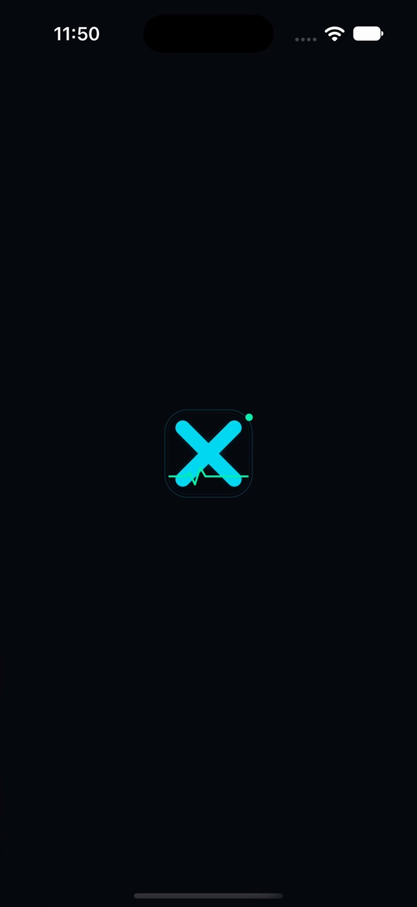
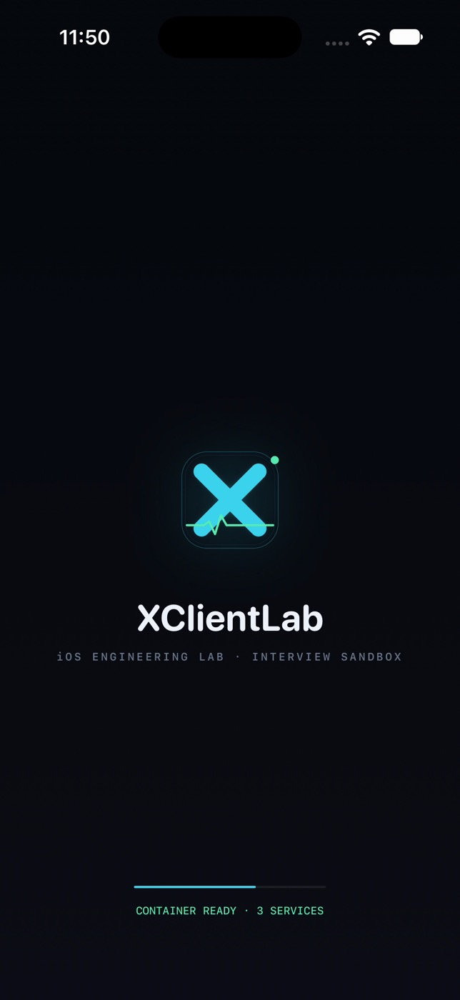

# 启动页：从系统 LaunchScreen 到可讲解的首屏动画

启动页在 iOS 上天然分为两层：**系统启动页（LaunchScreen）** 与 **App 内首屏（Splash）**。
前者是 App 首帧渲染前由 SpringBoard 展示的静态快照，必须有；后者才允许动画、读取状态。
本项目两层都做了，并且刻意让它们共用同一套视觉，交接时不会“跳一下”。

| 阶段 | 谁来画 | 内容 | 可动画 |
| --- | --- | --- | --- |
| 系统启动页 | `Info.plist` 的 `UILaunchScreen` | 品牌 logo + 深色底 | 否（系统只接受静态图 + 颜色） |
| App 内启动页 | `LaunchViewController` | logo、wordmark、tagline、容器状态、进度条 | 是（约 1s，随后 cross-dissolve 进主界面） |

## 1. 系统启动页：`UILaunchScreen`

`XClientLab/Info.plist`：

```xml
<key>UILaunchScreen</key>
<dict>
    <key>UIColorName</key>
    <string>LaunchBackground</string>
    <key>UIImageName</key>
    <string>LaunchLogo</string>
    <key>UIImageRespectsSafeAreaInsets</key>
    <false/>
</dict>
```

- `LaunchBackground`（`Assets.xcassets/LaunchBackground.colorset`）= `#07090E`，与 `LabUI.backgroundTop` 完全一致，首帧不会闪白。
- `LaunchLogo`（`Assets.xcassets/LaunchLogo.imageset`）= 120pt 品牌图：青色圆角描边 + X 胶囊 + 薄荷色脉冲线，1x/2x/3x 三档；透明底，放在纯色上。
- `UIImageRespectsSafeAreaInsets = false`：让系统把图居中在整个屏幕，而不是安全区。App 内启动页的 logo 也用 `view.centerYAnchor`，两边像素级对齐（实测偏差 < 1pt）。
- 旧的 `LaunchScreen.storyboard` 已删除：项目不需要维护两份启动页，`UILaunchScreen` 字典已经覆盖“单图 + 单色”的场景。

> 注意：系统启动页**不能**放文字、不能动画、不能加载数据。所有“像启动页”的动效都在 App 内首屏完成。

## 2. App 内启动页：`LaunchViewController`

文件：`XClientLab/App/LaunchViewController.swift`；入口在 `SceneDelegate`：

```swift
let root = RootTabBarController()
let launch = LaunchViewController { [weak window] in
    guard let window else { return }
    UIView.transition(with: window, duration: 0.42, options: [.transitionCrossDissolve]) {
        window.rootViewController = root
    }
}
window.rootViewController = launch
```

- `RootTabBarController` 在启动页展示期间就构造好，切换时零白屏、零卡顿。
- 背景是 `backgroundTop → backgroundBottom` 的 CAGradientLayer，与系统启动页的纯色底在同一色域内，肉眼不可分辨。
- 状态行先显示 `BOOTSTRAPPING CONTAINER`，0.45s 后变成 `CONTAINER READY · N SERVICES`，N 直接取自 `AppComposition.container.registeredServices.count` —— 启动页本身也参与“依赖注入”的讲解。

### 时间轴（总时长 ≈ 1.0s）

| t | 动作 |
| --- | --- |
| 0ms | 首帧：logo 在屏幕中心（与系统启动页同位置），alpha 0 → 1 |
| 0ms | logo 弹簧动画 0.62s：scale 0.88 → 1.0 |
| 100ms | wordmark + tagline 上移 8pt 淡入（0.45s） |
| 80ms | 底部 168×2 进度条从 0 拉满（0.82s） |
| 450ms | 状态行切到 `CONTAINER READY · N SERVICES`（薄荷色） |
| 980ms | `onFinish` → 0.42s cross-dissolve 到 `RootTabBarController` |

### 可访问性与测试

- `launch.logo` / `launch.wordmark` / `launch.status` 三个 accessibility id，UI 测试可直接断言。
- 下列情况直接跳过动画（立即进入主界面）：
  - 启动参数 `-skipLaunchAnimation`；
  - `XCTestConfigurationFilePath` 存在（UI 测试）；
  - 系统开启「减弱动态效果」（`UIAccessibility.isReduceMotionEnabled`）。
- 既有 UI 测试不依赖启动页，跳过逻辑只是让测试更快、更确定。

## 3. 怎么改

| 想改什么 | 改哪里 |
| --- | --- |
| logo 图形 | 替换 `LaunchLogo.imageset` 的 1x/2x/3x（保持 120pt 视觉尺寸） |
| 背景色 | `LaunchBackground.colorset` 与 `LabUI.backgroundTop` 必须同时改 |
| 文案 | `LaunchViewController` 里的 `wordmark` / `tagline` / `statusLabel` |
| 动画时长 | `runIntro()` 里的 delay / duration，以及 `+0.98` 的 finish 时刻 |
| 跳过条件 | `LaunchViewController.isAnimationEnabled` |

## 4. 面试讲法（30 秒）

> “启动页我拆成系统层和 App 层。系统层只放品牌图，用 `UILaunchScreen` 保证首帧就有内容、不闪白；App 层用 `LaunchViewController` 承接同一张图，做 1 秒以内的入场动效，然后 cross-dissolve 进主界面。两层共用背景色和 logo 尺寸，所以视觉上是连续的。状态行读的是 DI 容器的服务数，等于顺手把启动页接进了架构演示。测试和 Reduce Motion 会直接跳过动画。”

### 常见追问

- **为什么不用 `LaunchScreen.storyboard` 做动画？**
  系统启动页本身不支持动画；storyboard 只适合放静态视图，而且和 `UILaunchScreen` 二选一，维护两套没有收益。
- **启动页里加载远程配置吗？**
  不。冷启动首屏应当纯本地、无 IO；需要预热的数据放到主界面首屏异步加载，否则启动耗时不可控。
- **怎么证明启动耗时可接受？**
  `xcrun simctl` 录屏 + 抽帧可以看到系统启动页 → App 首帧的间隔；本项目在模拟器冷启动约 1.5–2s（首次安装），热启动 < 1s，动画本身固定 0.98s，不随网络波动。
- **为什么进度条是假的？**
  它是品牌动效，不是真实启动进度；真实启动没有可枚举的阶段，做“假进度”反而要解释成本。状态行展示的是真实的容器注册数。

## 5. 验证记录

- `xcodebuild build`（iPhone 16 Pro 模拟器）→ **BUILD SUCCEEDED**。
- `xcodebuild test -only-testing:XClientLabUITests` → **TEST SUCCEEDED**（2 个用例）。
- `swiftlint lint --config .swiftlint.yml` → 本项目既有基线，0 serious；启动页相关文件 0 violation。
- 截图（`simctl` 录屏抽帧）：
  - 系统启动页：
  - App 内启动页终态：

## 6. 边界

- 启动动画固定 ≈1s，不与真实 bootstrap 完成时间绑定；如果未来有必须等待的初始化，应改为“最短展示时间 + 完成回调”的组合。
- 系统启动页只保证“图 + 色”，改文字必须改 App 内启动页。
- 删除 `LaunchScreen.storyboard` 后若旧配置仍指向它，会回退成纯色底；本项目已确认 `INFOPLIST_KEY_UILaunchStoryboardName` 不存在。
