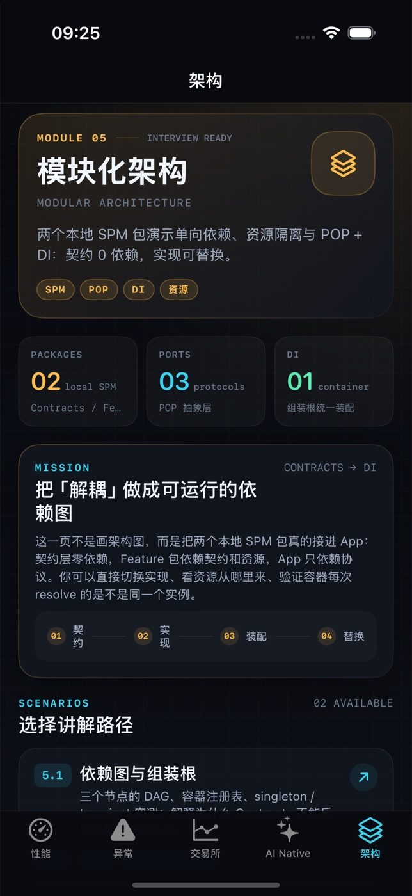
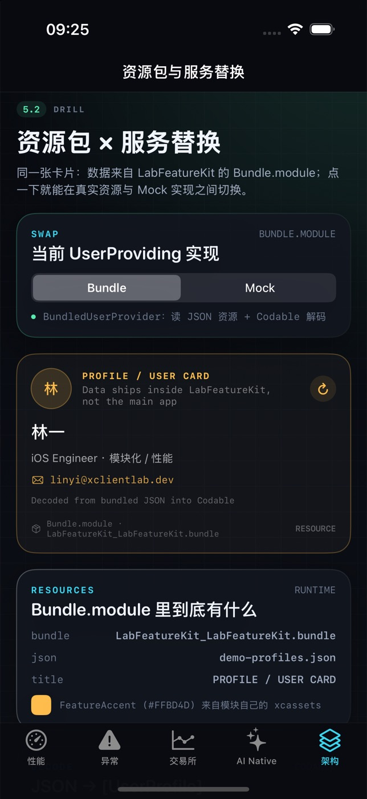

# 模块化架构：两个本地 SPM 包 + POP + DI

> 目标：把「模块解耦 / 相互依赖 / 资源处理 / 面向协议 / 依赖注入」变成可以当场运行、当场替换、当场验证的代码，而不是白板上的方框箭头。
>
> 入口：App 第 5 个 Tab「架构」（`LabModule.architecture`），含 5.1 依赖图与组装根、5.2 资源包 × 服务替换。

## 1. 目录与依赖方向

```
XClientLab/                         # App target：只做组装与导航
├── App/AppComposition.swift        # 组装根：唯一知道「协议 → 实现」的地方
├── Features/Architecture/          # 5.1 依赖图、5.2 资源/替换、三方库自检
└── ...

Packages/
├── LabContracts/                   # 契约层：0 依赖
│   └── Sources/LabContracts/
│       ├── Domain/UserProfile.swift          # Codable + Sendable 值类型
│       ├── Ports/UserProviding.swift         # 协议（端口）
│       ├── Ports/AnalyticsTracking.swift     # 协议
│       ├── Ports/FeatureModule.swift         # 模块自注册协议
│       └── DI/ServiceContainer.swift         # 轻量容器（transient / singleton）
└── LabFeatureKit/                  # 功能层：依赖 LabContracts + Alamofire
    └── Sources/LabFeatureKit/
        ├── UI/ProfileCardView.swift          # public View，只接收 any UserProviding
        ├── Infrastructure/                   # Bundled / Mock / Remote 三种实现
        ├── Services/UserDirectoryService.swift
        ├── ResourceSupport/FeatureResources.swift
        ├── Composition/FeatureKitModule.swift
        └── Resources/                        # JSON / Localizable / xcassets
```

依赖箭头永远单向：

```
XClientLab (App)
   │  import LabFeatureKit（只为构造 View）+ LabContracts
   ▼
LabFeatureKit (local SPM)
   │  import LabContracts（+ Alamofire）
   ▼
LabContracts (local SPM, 0 deps)
```

**为什么契约必须在最底层**：SwiftPM 不允许包依赖环。如果 `LabContracts` 反过来 import `LabFeatureKit`，解析阶段直接失败。依赖倒置让 App 编译期只看到协议，替换实现（Bundled / Mock / Remote）不需要改 App、View 或调用方。

## 2. 资源处理（Bundle.module）

`LabFeatureKit/Package.swift` 声明：

```swift
resources: [.process("Resources")]
```

于是 SwiftPM 生成 `Bundle.module`，产物是 `LabFeatureKit_LabFeatureKit.bundle`。`FeatureResources` 是唯一读取入口：

| 资源 | 读取方式 | 坑 |
| --- | --- | --- |
| JSON 数据 | `Bundle.module.url(forResource:withExtension:)` → `JSONDecoder` | 用 `.process` 后文件在 bundle 根目录；`.copy` 会保留子目录结构 |
| 本地化 | `NSLocalizedString(_:bundle: .module)`，`defaultLocalization: "zh-Hans"` | 必须有 `defaultLocalization`，否则 SwiftPM 拒绝解析；`zh-Hans.lproj` 目录名要精确 |
| 颜色 | `UIColor(named: "FeatureAccent", in: .module)` | 资源目录需带 `Contents.json`；读不到时回退 `systemTeal`，保证 demo 不白屏 |

要点：模块资源不经过主 App 的 `Assets.xcassets`，所以不会和 App 资源重名；App 也拿不到模块内部资源路径——这正是模块边界的体现。

## 3. 面向协议 + DI

### 3.1 端口与实现

```swift
public protocol UserProviding: Sendable {
    func user(withID id: String) async throws -> UserProfile
}
```

三个实现，全部在 `LabFeatureKit/Infrastructure/`：

- `BundledUserProvider`：读 `demo-profiles.json` + `Codable`，离线可讲；
- `MockUserProvider`：固定数据 + 120ms 延迟，演示 loading 态；
- `RemoteUserProvider`：Alamofire `serializingDecodable`，展示真实网络实现如何替换进来。

`UserDirectoryService` 再组合两个协议（provider + analytics），证明 DI 服务之间也通过协议协作，而不是互相 new。

### 3.2 容器（`LabContracts/DI/ServiceContainer.swift`）

```swift
@discardableResult
public func register<T>(_ type: T.Type = T.self, as name: String? = nil,
                        scope: Scope = .singleton,
                        factory: @escaping @Sendable () -> T) -> Self

public func resolve<T>(_ type: T.Type = T.self) -> T
public func resolveOptional<T>(_ type: T.Type = T.self) -> T?
public func contains<T>(_ type: T.Type = T.self) -> Bool
public var registeredServices: [String] { get }
```

- 注册的是**工厂**，不是实例：依赖延迟到 resolve 时再拼；
- `NSRecursiveLock`：允许工厂内部继续 `resolve`（组装链）；
- `singleton` 缓存实例，`transient` 每次新建；
- key 是 `ObjectIdentifier(type)`，所以注册/解析的类型必须完全一致——协议要写 `(any UserProviding).self`。

### 3.3 模块自注册

`FeatureModule` 协议只要求两件事：`static identifier` 和 `registerServices(in:)`。App 侧：

```swift
enum AppComposition {
    static let container = ServiceContainer()
    static let modules: [any FeatureModule] = [FeatureKitModule()]

    static func bootstrap() {
        for module in modules {
            module.registerServices(in: container)
        }
    }
}
```

新增一个功能模块时，App 只改 `modules` 数组，不用改任何分支逻辑；模块内部注册什么、用什么实现，App 不需要知道。

### 3.4 替换实现

```swift
FeatureKitModule().useMockProvider(in: AppComposition.container)
```

注册即覆盖。View 只持有 `any UserProviding`，切到 Mock 后卡片数据立刻变化，而 `ProfileCardView`、`AppComposition`、契约层一行都不用改——5.2 页面的 Bundle / Mock 分段控件就是这条路。

## 4. 5.1 / 5.2 页面各自证明什么

| 页面 | 可操作的证据 |
| --- | --- |
| 5.1 依赖图与组装根 | 容器注册表（`registeredServices`）；`singleton` 两次 resolve 为同一对象、`transient` 每次新对象（`===` 实测） |
| 5.2 资源包 × 服务替换 | 卡片数据来自 `Bundle.module` 的 JSON；Bundle/Mock 切换；`Bundle.module` 名称、JSON 文件名、本地化串、品牌色；`UserDirectoryService` 链路（profile.open → profile.loaded） |
| 5 Tab 首页 | 三方库真实调用自检（Alamofire / Kingfisher / Moya / SnapKit / Starscream） |

## 5. 面试话术（约 3 分钟）

1. **先给依赖图**：App → FeatureKit → Contracts，单向、无环；契约层 0 依赖，是整个架构的地基。
2. **再讲资源**：模块自带 `Resources`，`Bundle.module` + `defaultLocalization`；JSON / 本地化 / 颜色都封在包内，App 不知道文件在哪。
3. **讲装配**：`AppComposition` 遍历 `FeatureModule` 注册工厂；容器只管生命周期，业务类型只认协议。
4. **现场替换**：切到 Mock，卡片变了，View 没改——这就是 POP + DI 的收益，也是可测试性的来源。
5. **收尾**：5 Tab 的三方库自检说明依赖不是「挂在工程里好看」，每个库都有真实调用点。

## 6. 常见追问与回答

- **为什么不用第三方 DI 框架（Factory / Swinject）？** 演示容器 80 行、无依赖、可读；真实项目可以替换实现，因为业务侧只依赖 `ServiceContainer` 的三个方法（或再抽一层 `Resolver` 协议）。
- **单例怎么测试？** `ServiceContainer` 是实例而非全局单例，测试里 new 一个容器注册 Mock 即可；`removeAll()` 用于用例隔离。
- **资源冲突怎么办？** 每个包独立 bundle，命名空间天然隔离；重名的 `FeatureAccent` 在 App 里读不到，必须 `in: .module`。
- **循环依赖怎么防？** 契约层不允许 import 任何功能包；Feature 包之间也不互相 import，需要协作时把协议下沉到 Contracts。
- **Remote 实现会不会把网络层泄漏到 App？** 不会：App 只看到 `UserProviding`；Alamofire 只出现在 LabFeatureKit 内部。

## 7. 截图





## 8. 验证记录（2026-11-10）

```bash
xcodebuild -project XClientLab.xcodeproj -scheme XClientLab \
  -sdk iphonesimulator -destination 'generic/platform=iOS Simulator' \
  -derivedDataPath ./DerivedData CODE_SIGNING_ALLOWED=NO \
  -skipPackagePluginValidation build      # BUILD SUCCEEDED

swiftlint lint --no-cache --config .swiftlint.yml
# Found 0 violations, 0 serious in 28 files
```

- 模拟器 iPhone 16 Pro：Tab「架构」正常渲染；5.2 卡片显示 `林一 / iOS Engineer`，`Bundle.module` 为 `LabFeatureKit_LabFeatureKit.bundle`，资源列表读到 `demo-profiles.json`、本地化标题与 `#FFBD4D` 品牌色。
- 本地包通过 `XCLocalSwiftPackageReference` 接入 `project.pbxproj`（`relativePath = Packages/LabContracts` / `Packages/LabFeatureKit`）；远程包仍由 `XCRemoteSwiftPackageReference` 管理，`Package.resolved` 只 pin 远程依赖。
