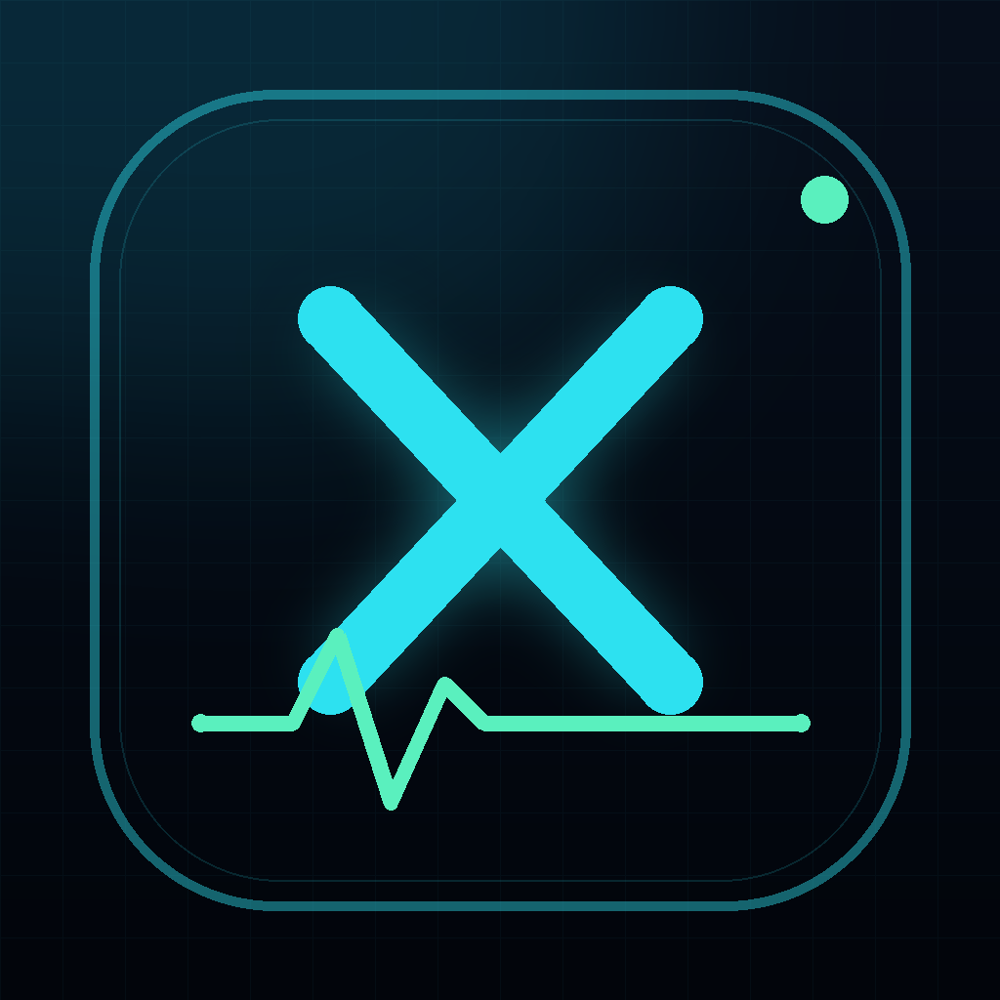
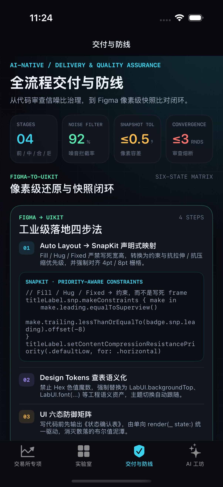
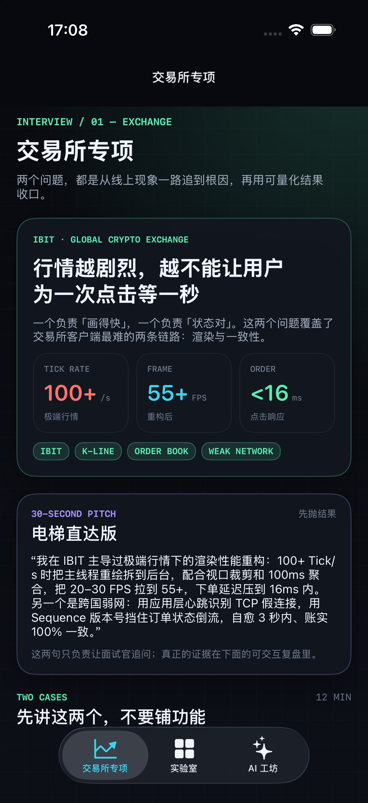
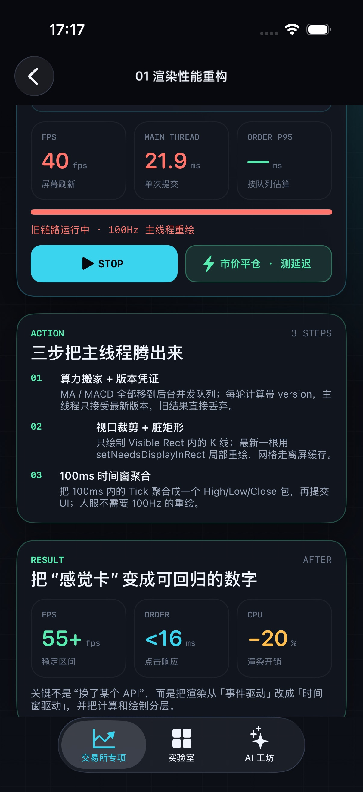
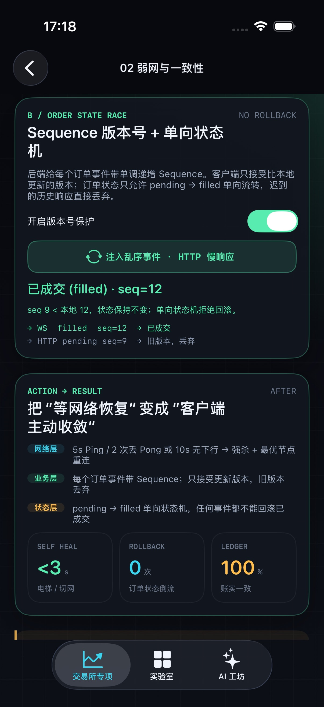
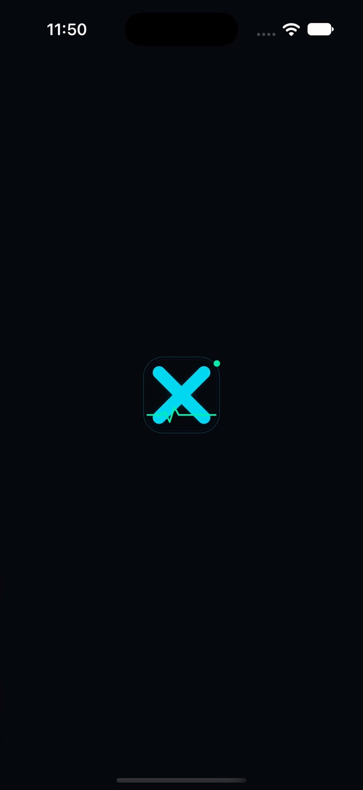
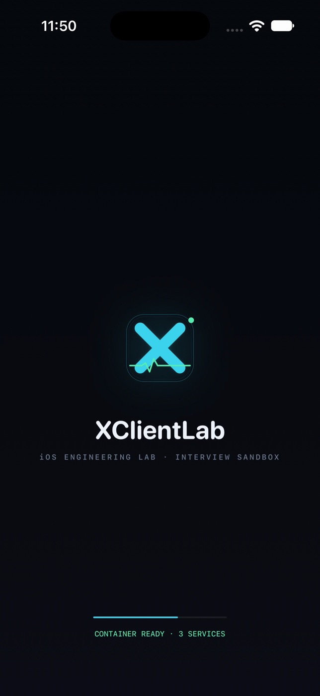

# XClientLab

> 一个从零构建的 iOS 高级 / 资深开发面试 Sandbox：用可复现的异常、可观测的指标和可审计的 AI-Native 工作流，把「做过」讲成「能证明」。

现在的主线不是「铺十个功能」，而是 **交易所专项的两个真实问题**：极端行情下的渲染性能重构，以及跨国弱网下的 TCP 假连接 + 订单状态竞态。首屏直接给出问题、难点、动作和结果，再进入可交互复盘。



## 快速开始

环境基线：Xcode 27.1（27A9275）、iOS 18.0+、Swift 5 language mode、UIKit + MVVM + Combine；界面全部用代码构建，约束使用 SnapKit，无 SwiftUI / 无 Storyboard。第三方库经 SPM 接入（Alamofire / Kingfisher / Moya / SnapKit / Starscream，外加 SwiftLint 构建期插件）；另有 `Packages/` 下两个本地 SPM 包（LabContracts / LabFeatureKit）演示模块化架构、POP + DI 与模块资源。

```bash
open XClientLab.xcodeproj
```

选择任意 iPhone 模拟器，Run。所有页面均为真实 UIView 层级，可直接用 Xcode Debug View Hierarchy 讲解；首次从旧版本升级到 UIScene 生命周期时，若模拟器仍显示黑屏，先 `xcrun simctl uninstall booted e88ebfa25316fd8c.XClientLab` 再安装，清掉遗留的 legacy scene session。

命令行构建（已验证）：

```bash
xcodebuild -project XClientLab.xcodeproj \
  -scheme XClientLab \
  -sdk iphonesimulator \
  -destination 'generic/platform=iOS Simulator' \
  -derivedDataPath ./DerivedData \
  CODE_SIGNING_ALLOWED=NO \
  -skipPackagePluginValidation \
  -disableAutomaticPackageResolution build
```

依赖解析与常用命令都收敛在 Makefile：

```bash
make resolve   # 解析 SPM 依赖，更新 Package.resolved
make build     # 命令行构建
make lint      # SwiftLint（与构建期插件同一份 .swiftlint.yml）
make format    # SwiftFormat 全量格式化（会改动既有代码，按需执行）
make format-check  # 只检查不修改；当前基线 19/28 文件未格式化，未纳入门禁
```

> 如果在本机沙盒环境中遇到 Swift 宏插件报 `sandbox_apply: Operation not permitted`，请给 xcodebuild 外层进程完整的文件/沙盒权限。Xcode 的宏插件需要嵌套 sandbox，普通 workspace-write 会拦截。

## 验证结果

最近一次本机验证（iPhone 17 Pro / iOS 26；此前也在 iPhone 18 Pro Max / iOS 27.1 通过）：

- `xcodebuild ... -skipPackagePluginValidation build` → `** BUILD SUCCEEDED **`
- `make test` → `** TEST SUCCEEDED **`
- `fastlane test` / `xcodebuild test` → 44 个用例，0 失败。

测试分层：

| 层 | 用例数 | 覆盖 |
| --- | ---: | --- |
| 纯领域逻辑 | 20 | 金额/时间换算、行情解析、委托校验 |
| 网络 + ViewModel | 6 | `MarketDataProviding` Mock、loading/loaded/failed 状态、重试、符号归一化 |
| UI 组件快照 | 4 | 模块头、卡片、指标行、AI Callout（swift-snapshot-testing） |
| 既有核心回归 | 6 | 盘口合并、重连退避、CPU payload、Allocations 数据、Markdown 解析、12 档盘口 |
| 核心 UI 链路 | 7 | 交易所首屏、渲染案例入口、一致性案例、1.1 入口、CPU RUN 回 IDLE、CPU reset、3.2 盘口 START/STOP |

测试分层、Mock 约定与快照基线维护见 [Docs/Testing.md](Docs/Testing.md)；交易所主线的完整讲法见 [Docs/Exchange-Story.md](Docs/Exchange-Story.md)。

## 常见问题

### Xcode 报 `No such module 'SnapshotTesting'`

项目已把 `swift-snapshot-testing 1.17.6` 链接到 `XClientLabTests`，并在 `Package.resolved` 中锁定版本。命令行从空 DerivedData 构建也能通过，因此这个报错通常是 Xcode 的 SPM 缓存没有重新解析，而不是源码缺少依赖。

按顺序处理：

1. 退出 Xcode。
2. 终端执行 `make resolve`。
3. 删除 Xcode 为本项目生成的旧缓存：`rm -rf ~/Library/Developer/Xcode/DerivedData/XClientLab-*`。
4. 重新打开 `XClientLab.xcodeproj`，执行 **File > Packages > Reset Package Caches**，再 **Product > Clean Build Folder**。
5. 确认 `XClientLabTests/ComponentSnapshotTests.swift` 的 Target Membership 是 `XClientLabTests`，且该 target 的 Frameworks 中有 `SnapshotTesting`。

验证单条快照测试：

```bash
xcodebuild test -project XClientLab.xcodeproj -scheme XClientLab \
  -destination 'platform=iOS Simulator,name=iPhone 18 Pro Max' \
  -only-testing:XClientLabTests/ComponentSnapshotTests \
  CODE_SIGNING_ALLOWED=NO -skipPackagePluginValidation
```

如果 `import SnapshotTesting` 被写进了 `XClientLab` 或 `XClientLabUITests` target，也会出现同样的报错；该依赖目前只属于 `XClientLabTests`。

### `Could not resolve package dependencies` / ReactiveSwift submodule 报错

如果日志出现：

```text
Couldn't update repository submodules:
fatal: could not open .../ReactiveSwift/.git/modules/.../tmp_pack_...
```

这是 Xcode 默认 DerivedData 里的 `ReactiveSwift` checkout 损坏，不是项目依赖写错。清掉该项目的 SourcePackages 后重新解析即可：

```bash
rm -rf ~/Library/Developer/Xcode/DerivedData/XClientLab-*/SourcePackages
xcodebuild -resolvePackageDependencies -project XClientLab.xcodeproj -scheme XClientLab
```

也可以在 Xcode 里执行 **File > Packages > Reset Package Caches**。`ReactiveSwift` 是 Moya 的传递依赖，当前快照/单元测试并不直接使用它。

### Xcode 显示 `Missing package product 'Alamofire'`

如果刚清理过 `SourcePackages`，但 Xcode 仍显示 `Missing package product 'Alamofire'` / `'Kingfisher'`，这是 Xcode 进程里的旧 Package Graph 还没有重新加载。命令行验证可以正常构建时，优先按下面处理：

1. **完全退出 Xcode**（`Cmd-Q`，不是只关窗口）。
2. 终端执行 `make resolve`。
3. 重新打开 `XClientLab.xcodeproj`，等待右上角包解析完成。
4. 仍不恢复时：`File > Packages > Reset Package Caches`，然后 `File > Packages > Resolve Package Versions`。

不要在 Xcode 正在构建或解析包时删除 `DerivedData`，否则容易出现上面的半初始化状态。

## 第三方依赖

| 包 | 版本 | 用途 |
| --- | --- | --- |
| Alamofire | 5.12.2 | HTTP 会话 / 重试 / 事件拦截 |
| Kingfisher | 8.15.0 | 图片下载与内存、磁盘缓存 |
| Moya | 15.0.3 | 类型安全 API 抽象（依赖 Alamofire） |
| SnapKit | 6.0.0 | UIKit 声明式 Auto Layout |
| Starscream | 4.0.8 | WebSocket 客户端 |
| SwiftLintPlugins | 0.65.1 | 构建期 SwiftLint 检查 |
| SwiftFormat | 0.64.6 | 代码格式化（CLI） |

接入细节、`plugin:` 前缀的坑、以及为什么 SwiftFormat 只能走 CLI，见
[Docs/ThirdParty.md](Docs/ThirdParty.md)。版本 pin 在 `Package.resolved` 中随仓库提交。

> Xcode GUI 首次构建会询问是否信任 SwiftLint 的 build tool plugin；命令行构建需
> `-skipPackagePluginValidation`（Makefile 已内置）。

## 首屏与 Tab 结构

底部有四个 Tab：**交易所专项 / 实验室 / 交付与防线 / AI 工坊**，默认落在「交易所专项」。交易所主线包含两个案例：

1. **案例一 · 极端行情渲染性能重构**：100+ Tick/s 下旧链路全量重绘，主线程单次提交 ~21.8ms，订单 P95 超过 1s；切到「聚合 + 裁剪」后 API 不变、主线程只接收最新版本。页面可亲手切换两条链路、点「市价平仓」测延迟。
2. **案例二 · 跨国弱网 + 订单状态竞态**：应用层 5s Ping / 2 次丢 Pong / 10s 无下行判定假连接；订单事件用单调 Sequence + pending → filled 单向状态机拒绝旧版本。页面可注入「电梯断网」和「HTTP 慢响应」，观察自愈与拒绝回滚。

第 3 个 Tab「交付与防线」先讲 Figma 六态与像素快照闭环，再讲 AI 代码审查的信噪比治理、三轮收敛与风险分级，最后落到 Git Flow 分支 / 提交 / 发布纪律。







## 五个模块

| 模块 | 场景 | 可演示证据 |
| --- | --- | --- |
| 01 性能优化 | 01 启动速度与包大小 | 本次启动实测、ObjC 类/dyld 镜像/Bundle 大小、pre-main/main-post 清单 |
| 01 性能优化 | 02 UI 渲染 | 层级/透明、cell 复用/高度缓存、圆角离屏、重绘 |
| 01 性能优化 | 03 网络请求 | 合并/single-flight、NSCache/MMKV/SQLite、弱网超时与退避 |
| 01 性能优化 | 04 内存 | 循环引用/Timer/通知、分页/降采样、Leaks / Allocations / Memory Graph |
| 01 性能优化 | 05 CPU 与主线程 | 主线程下沉、字典 vs 数组、缓存、锁竞争与优先级反转 |
| 01 性能优化 | LIVE CPU / Alloc | 极端档 >500ms 停顿、Hitch 统计、footprint 锯齿、Peak/Churn |
| 02 异常攻坚 | 2.1 DispatchSourceTimer 释放瞬间野指针 | `EXC_BAD_ACCESS` / `KERN_INVALID_ADDRESS 0x1d`、系统栈取证报告、LLDB 批处理 |
| 02 异常攻坚 | 2.2 多线程非原子读写与 munmap 踩踏 | 丢失写次数、TSan 报告、并发踩踏现场 |
| 03 交易所专项 | 3.1 弱网 WS 重连 | 状态机、指数退避 0.5→8s、±20% jitter、6 次上限、EXHAUSTED |
| 03 交易所专项 | 3.2 高频盘口 | 83 条/s 全量推送、单槽节流、按价位 Diff、60/120Hz hitch 指标 |
| 04 AI-Native | 4.1 MCP 通道纪律 + Skills | 通道状态机、越权命令拦截、内置 Markdown Skill 预览 |
| 04 AI-Native | 4.2 Terminal-first 自动化 | 一键生成 XCTest 桩 / LLDB 断点 / MCP 计划并落盘 |
| 04 AI-Native | 4.3 交付与防线 | Figma 六态 + 像素快照 ≤0.5%、信噪比过滤与 3 轮收敛熔断、Git Flow 与 Conventional Commits |
| 05 模块化架构 | 5.1 依赖图与组装根 | 两个本地 SPM 包的单向依赖、容器注册表、singleton / transient 实测 |
| 05 模块化架构 | 5.2 资源包 × 服务替换 | `Bundle.module` 的 JSON / 本地化 / 颜色资源、Bundle ↔ Mock 一行切换、UserDirectoryService 链路 |

## 架构

```
XClientLab/
├── App/                 # AppDelegate / SceneDelegate / LaunchViewController / RootTabBarController / AppComposition
├── UIKit/               # LabUI 色板、LabComponents、LabBaseViewController、MarkdownPreviewView
├── ViewModels/          # Performance / Exception / Exchange / AINative（@MainActor + Combine）
├── Models/              # LabModule、LogEntry、DebugSkill 与 Markdown 解析
├── Core/                # HitchMonitor、MemoryProbe、格式化工具
└── Features/
    ├── ExchangeStory/   # 面试主线：IBIT 两个案例 + 可交互复盘
    ├── Home/            # ModuleHomeViewController + 5 个模块首页
    ├── Performance/     # 五条优化链路 + CPUStall / AllocationStorm 实测
    ├── Exceptions/      # 2.1 UAF、2.2 Race、CrashProbe
    ├── Architecture/    # 5.1 依赖图、5.2 资源/替换、三方库自检
    ├── Exchange/        # 3.1 Reconnect、3.2 OrderBook
    └── AINative/        # 4.1 Skills + MCP Channel、4.2 Terminal Automation、4.3 Delivery & QA

Packages/
├── LabContracts/        # 本地 SPM：契约层（Domain / Ports / DI），0 依赖
└── LabFeatureKit/       # 本地 SPM：UI + 实现 + Resources，依赖 LabContracts + Alamofire
```

- 每个实验一个 `@MainActor ObservableObject` ViewModel（Combine），持有可观测指标、状态机与日志；ViewController 只做绑定和导航。
- 页面层只负责编排与展示；破坏性操作有二次确认和明确的演示边界。
- 所有场景都有「古法排查痛点」与「AI MCP 新实践切入点」注释，方便面试时直接讲设计取舍。

## 启动页

两层结构，共用同一套视觉，交接不跳变：

- **系统启动页**：`Info.plist` 的 `UILaunchScreen`（`LaunchBackground` + `LaunchLogo`）。单图 + 单色，首帧即有内容，不闪白。
- **App 内启动页**：`XClientLab/App/LaunchViewController.swift`。承接同一张 logo，做 ≤1s 的入场动效（logo 弹簧、wordmark 淡入、进度条、`CONTAINER READY · N SERVICES`），随后 cross-dissolve 进 `RootTabBarController`。
- 跳转逻辑在 `SceneDelegate`：启动页展示期间就构造好根 Tab，切换零白屏；`-skipLaunchAnimation`、UI 测试、Reduce Motion 会直接跳过动画。

细节、时间轴与面试话术见 [Docs/LaunchScreen.md](Docs/LaunchScreen.md)。




## 演示动线

推荐 15–20 分钟，先主线、后追问：

0. 冷启动：启动页 → 交易所专项首屏（1 秒内），先讲系统 LaunchScreen 与 App 内动效的分层。
1. 交易所专项 01：30 秒电梯版 → 亲手跑旧链路（40 FPS / 21.8ms / P95 1000+ms）→ 切重构链路 → 讲三步改造与结果。
2. 交易所专项 02：注入电梯断网（2.8s 自愈）→ 注入 HTTP 慢响应（拒绝 seq=9 回滚）→ 讲心跳与单向状态机。
3. 追问时再进「实验室」：性能五条链路（启动/UI/网络/内存/CPU）+ 两个实测、异常 2.1 / 2.2、交易所 3.1 / 3.2。
4. 交付与防线：Figma 六态 / 快照闭环 → 审查信噪比与收敛 → Git Flow 与 Conventional Commits。
5. AI 工坊：通道纪律、Skill 沉淀、自动化产物。
6. 架构 5.1 → 5.2：先看单向依赖与容器，再切 Mock 证明替换成本为零。

完整讲解脚本见 [Docs/Interview-Walkthrough.md](Docs/Interview-Walkthrough.md)。

## 重要边界

- 2.1 / 2.2 的「DANGER ZONE」会**真实崩溃当前 App**，只用于 Debug 演示；崩溃后从 Xcode 重新 Run 即可。
- 2.1 的崩溃报告是取证样例，字段用于讲解定位路径；真实地址会随运行环境变化。
- 4.2 生成的文件在 App 沙盒 `Documents/XClientLabAutomation/`。生成的 XCTest 桩需要手动加入 `XClientLabTests` target 才能被 `xcodebuild test` 发现，这是 iOS 沙盒无法修改 Xcode 工程的客观边界。
- 本项目不包含真实交易所网络连接，WS 弱网与盘口推送均为确定性模拟，目的是让实验可重复、可讲解。

## 文档

- [第三方依赖与工具链](Docs/ThirdParty.md)
- [启动页：系统 LaunchScreen + App 内首屏](Docs/LaunchScreen.md)
- [模块化架构：本地 SPM + POP + DI](Docs/ModuleArchitecture.md)
- [交易所主线讲法](Docs/Exchange-Story.md)
- [面试演示脚本](Docs/Interview-Walkthrough.md)
- [AI-Native 工程化实战手册 (面试精讲白皮书)](Docs/AI-Engineering-Playbook.md)
- [LLDB 异步崩溃 Skill](Docs/LLDB-Async-Crash-Skill.md)
- [Terminal-first 自动化说明](Docs/Terminal-Automation.md)
